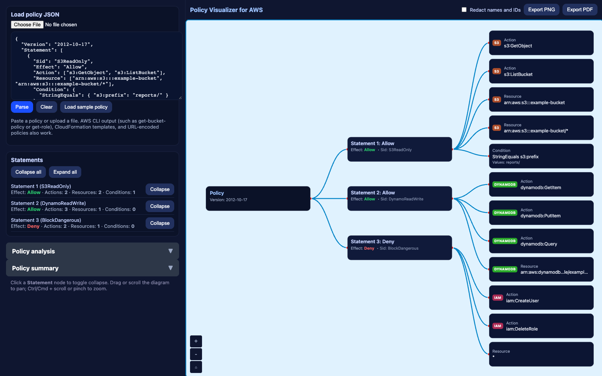

# Policy Visualizer for AWS

> **Disclaimer:** This tool is sample code provided for educational purposes. It is not intended for production use without additional security review and testing. Its findings are a starting point and do not replace IAM Access Analyzer policy validation or your own review.

Policy Visualizer for AWS draws an AWS IAM policy as a diagram and checks it
for common mistakes. It runs entirely in your browser.



## What it does

- Draws the policy, its statements, and their actions, resources, principals,
  and conditions as a diagram you can pan, zoom, and collapse.
- Describes each statement in plain English and lists its permissions in a
  table.
- Runs offline checks and reports findings. See [Findings](#findings).
- Compares the policy with a previous version.
- Shows whether this one policy allows an action on a resource (Check access).
- Builds a narrower policy from the permissions you mark as needed (Optimize).
- Exports the diagram as PNG or PDF, and copies findings as Markdown.
- Optionally replaces account IDs, resource names, and other identifying
  values with placeholders. See [Redaction](#redaction).

You can paste or upload policy JSON, AWS CLI output such as
`get-bucket-policy`, `get-role`, or `organizations describe-policy`, a
CloudFormation template, or a URL-encoded policy.

## Findings

The checks look for:

- public and cross-account principals;
- wildcard and sensitive actions, and `iam:PassRole` on any role;
- S3 actions that don't match their bucket or object ARNs;
- `NotAction`, `NotResource`, and `NotPrincipal` with Allow;
- condition operator pitfalls: `ForAllValues`, `ForAnyValue`, wildcards in
  `StringEquals`, and `IfExists`;
- an old or missing `Version`, duplicate `Sid` values, and size limits.

Findings depend on the policy type: identity, resource-based, trust, SCP or
RCP, or permissions boundary. Trust policies and SCPs/RCPs are detected from
exact wrapper keys (`AssumeRolePolicyDocument`, and `Policy.Content` from
`organizations describe-policy`), identity, resource-based, and trust
policies from the contents, and a permissions boundary only when you pick it.
You can change the type. For SCPs, RCPs, and permissions boundaries the
"grants too much" checks are off, and the findings say so.

These checks cover common mistakes only and do not replace IAM Access
Analyzer policy validation.

## Compare, Check access, and Optimize

- **Compare** shows added and removed statements, actions, resources,
  principals, conditions, and findings. A statement counts as changed when
  anything in it other than its Sid changes, so moving an action, principal,
  or condition to another statement shows up even though the policy-wide
  lists stay the same.
- **Check access** looks at this one policy only. It lists conditions and
  policy variables instead of evaluating them.
- **Optimize** keeps Deny statements, `NotAction`/`NotResource`, and
  statements with more action and resource pairs than the table shows as
  written, and keeps the policy `Version` as it was. Review the result, and
  validate it with IAM Access Analyzer, before you use it.

## Redaction

Turn on **Redact names and IDs** before you take a screenshot or share an
export. It replaces account IDs, resource names, Sids, condition values, and
unrecognized element names with placeholders across the page: the diagram,
tables, findings, comparison, Check access results, Copy as Markdown, and PNG
and PDF exports. It also hides the pasted policy text and masks the Check
access resource and caller fields.

Kept as they are:

- action names, service principals, and condition keys, except tag names (as
  in `aws:ResourceTag/<key>`) and web identity provider hosts, which are
  replaced;
- Region names in condition values;
- in an ARN, the partition, service, and Region fields, whatever they
  contain, and the first part of the resource, which is normally its type
  (`table`, `role`);
- in an ARN, wildcards and known policy variables: documented `aws:` keys
  such as `${aws:username}`, `saml:` keys, `sts:RoleSessionName` and
  `sts:SourceIdentity`, and the keys of public identity providers.

Replaced:

- the ARN account field, unless it is `aws` (AWS managed policies), keeping
  only wildcards and policy variables;
- a tag key inside a variable (`${aws:PrincipalTag/KEY-1}`);
- any other `${...}` text, keeping its shape (`${KEY-1:KEY-2}`,
  `${aws:KEY-3}`).

A variable's default value follows the condition value rules, so `true`,
`false`, short numbers, Regions, and `<service>.amazonaws.com` names stay and
anything else is replaced. For an ARN whose resource starts with a name
instead of a type, such as an SNS subscription (`...:<topic>:<id>`), that
name is shown.

Redaction changes only what is shown: analysis uses the real policy, and the
Optimize download contains the real values. It is best effort, so check the
output before you share it.

## Runs entirely in your browser

The app is a static single-page application. It does not send your policy
anywhere: parsing, analysis, rendering, and export all happen locally in the
browser. There is no backend, no telemetry, and nothing is stored.

## Requirements

- Node.js 22.12 or newer
- npm

## Run locally

```bash
npm ci
npm run dev
```

Then open the URL printed by Vite (default `http://localhost:3000`). Use
**Load sample policy** to try it with the bundled `public/sample-policy.json`,
or paste your own policy JSON.

## Build

```bash
npm run build
```

The production build is written to `dist/`. Preview it with:

```bash
npm run preview
```

### Base path

The Vite base path defaults to `./`, so the build works from a web root, a
subfolder, or GitHub Pages without changes. To set an explicit base path, pass
`VITE_BASE` at build time:

```bash
VITE_BASE=/my-subpath/ npm run build
```

### Hosting

If you host the build publicly, serve it over HTTPS and set a full
`Content-Security-Policy` header at the web server or CDN, including
`frame-ancestors 'none'` (or set `X-Frame-Options: DENY`) so other sites
can't frame the page. The build includes a `<meta>` policy (see
`vite.config.ts`), but a `<meta>` policy cannot set `frame-ancestors`.

## Test and lint

```bash
npm test       # run unit tests once
npm run lint   # eslint, zero warnings allowed
```

### Browser tests

The browser tests in `e2e/` use [Playwright](https://playwright.dev/). They
build the app, serve the production build on `127.0.0.1`, and check the
diagram, analysis panel, optimized policy download, and PNG/PDF export. They
also fail if the page makes any request outside its own origin.

```bash
npx playwright install chromium   # once, downloads the test browser
npm run test:e2e
```

To use an installed Google Chrome instead of the downloaded browser, set
`PW_CHANNEL=chrome`. To test a subfolder deployment such as GitHub Pages, set
`E2E_BASE=/policy-visualizer/`.

## Security

See [CONTRIBUTING](CONTRIBUTING.md#security-issue-notifications) for more information.

## License

This project is licensed under the Apache-2.0 License. See [LICENSE](LICENSE) and [NOTICE](NOTICE).
